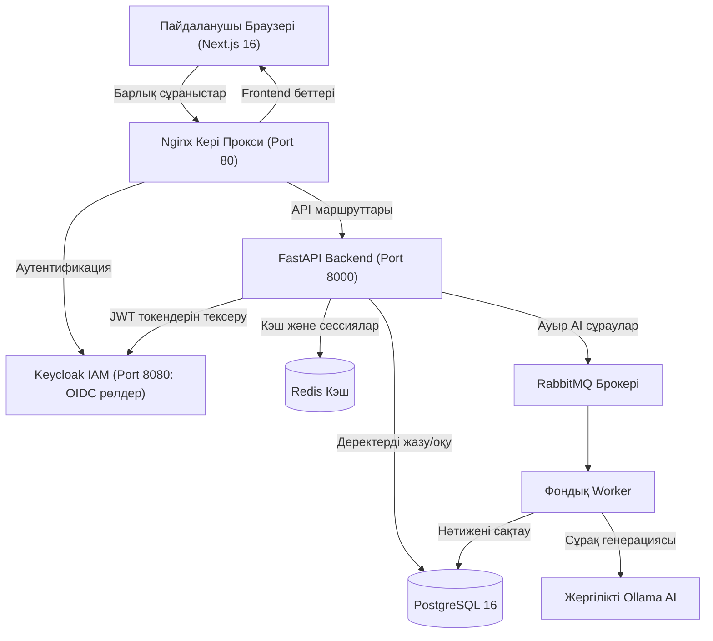

# 🎓 EduPlatform — Заманауи Білім Беру және Тестілеу Платформасы

Заманауи микросервистік архитектураға негізделген, оқытушылар мен студенттерге арналған толық циклді (full-stack) білім беру жүйесі. Жобада жергілікті **Ollama AI** менторы, **Keycloak OIDC** қауіпсіздік жүйесі, **RabbitMQ** хабарлама кезегі және **Анти-списывание** (прокторинг) тетіктері толықтай жүзеге асырылған.

---

## 🛠️ Технологиялық Стек

| Қабат | Қолданылған технологиялар |
|---|---|
| **Frontend** | **Next.js 16** (React 19, App Router, TypeScript, Tailwind CSS, Lucide Icons) |
| **Backend** | **FastAPI** (Python 3.11+, Pydantic v2, Uvicorn, aiofiles) |
| **Деректер қоры** | **PostgreSQL 16**, **SQLAlchemy 2** (Async / `asyncpg`), **Alembic** (миграциялар) |
| **Аутентификация (IAM)** | **Keycloak 24** (OIDC, OAuth2, RBAC: `student`, `teacher`, `admin`) |
| **Жергілікті AI (LLM)** | **Ollama** (`llama3.2`, сұрақтар генерациясы, жауаптарды талдау) |
| **Асинхронды өңдеу** | **RabbitMQ** (AMQP брокері), **Worker** (`aio-pika`), **Redis 7** (кэштеу) |
| **Инфрақұрылым** | **Docker Compose**, **Nginx** (кері прокси), **Pytest** |

---

## 🏛️ Жүйенің Архитектуралық Диаграммасы



---

## 🌟 Жобаның Негізгі Мүмкіндіктері

### 1. 👨‍🏫 Мұғалім кабинеті (`/teacher`):
* **Тест конструкторы:** уақыт шегімен (таймер) онлайн тесттер құру.
* **Ollama AI көмекшісі:** кез келген тақырып бойынша 1 батырмамен тест сұрақтарын автоматты құрастыру.
* **Үй тапсырмалары:** дедлайн белгілеп, тапсырма беру және студент жұмыстарын бағалау.
* **Бағалар журналы және Экспорт:** барлық үлгерімді кестеден көру және **Excel/CSV** форматында ведомостіні жүктеп алу.

### 2. 👨‍🎓 Студент кабинеті (`/student`):
* **Онлайн тестілеу:** 25 минуттық кері санақ таймерімен тест тапсыру.
* **Авто-бағалау:** тест аяқталған бойда нәтижені бірден есептеу (мысалы, 100%).
* **Ollama AI Ментор:** қателер мен нәтиже бойынша қазақ тілінде түсініктеме мен кеңес алу.
* **Үй жұмысы:** жауап жазу және нақты файлдарды (**PDF**, суреттер, архивтер) тіркеп тапсыру.

### 3. 🛡️ Анти-списывание (Прокторинг қорғанысы):
* **Вкладкадан шығуды бақылау (`visibilitychange`):** студент тест кезінде басқа терезеге немесе сайтқа өтсе, экранға ескерту шығады (`1/3`, `2/3`). 3 рет ереже бұзылса — тест автоматты жабылады.
* **Сұрақтар мен нұсқаларды араластыру:** әр студент үшін сұрақтар мен нұсқалар кездейсоқ тәртіппен беріледі.
* **Мәтінді көшіруді бұғаттау:** сұрақты белгілеп, көшіруге (`Ctrl+C`) тыйым салынған.

### 4. 📚 Пәндер каталогы (`/courses`):
* Мұғалім үшін жаңа курс ашу (`CS101`, `CS102`, т.б.).
* Студент үшін қалаған курсына бір батырмамен жазылу (**Enroll**) және «Менің пәндерім» қойындысын қарау.

### 5. 🔔 Жедел Хабарламалар (Notifications):
* Жоғарғы мәзірде жаңа бағалар мен жарияланған тесттер туралы қалқымалы интерактивті қоңырауша.

### 6. 👤 Жеке Профиль және Марапаттар (`/profile`):
* Пайдаланушының жеке ақпараты, GPA орташа үлгерім балы және цифрлық жетістік белгілері (**Badges**).

---

## 🚀 Іске қосу нұсқаулығы

### 1. Docker Compose арқылы (Барлық сервистерді бірден қосу):

```bash
# Қауіпсіздік пен дайындықты тексеру:
./agent_cmd

# Барлық 8 сервисті іске қосу:
./agent_cmd start
# немесе: docker compose up -d
```

### 2. Жергілікті дамыту режимінде (Local Dev):

```bash
# 1. Frontend-ті қосу (Next.js 16):
cd web
npm install
npm run dev

# 2. Backend-ті қосу (FastAPI):
cd backend
python3 -m venv .venv
source .venv/bin/activate
pip install -r requirements.txt
uvicorn app.main:app --reload --port 8000
```

---

## 🌐 Қолжетімді Порттар мен Сілтемелер

| Сервис | Мекенжай | Сипаттамасы |
|---|---|---|
| **Frontend қолданбасы** | [http://localhost:3000](http://localhost:3000) | Негізгі пайдаланушы интерфейсі |
| **Backend API Swagger** | [http://localhost:8000/docs](http://localhost:8000/docs) | Интерактивті API құжаттамасы |
| **Keycloak IAM** | [http://localhost:8080](http://localhost:8080) | Пайдаланушыларды басқару және OIDC |
| **RabbitMQ Management** | [http://localhost:15672](http://localhost:15672) | Хабарламалар кезегінің басқару панелі |
| **Nginx Кері Прокси** | [http://localhost](http://localhost) | Барлық сервистерді біріктіретін жалпы нүкте |

---

## 🔒 Қауіпсіздік және Құпия Деректерді Қорғау

* Нақты парольдер мен кілттер **`.env`** файлында оқшауланған.
* **`.gitignore`** файлдары `.env`, `.venv/`, `node_modules/`, `*.log` файлдарының GitHub-қа өтуіне қатаң тыйым салады.
* Репозиторийде тек үлгі ретінде [`.env.example`](.env.example) файлы сақталады.
* **`agent_cmd`** скрипті Git-ке жіберілетін әрбір коммитті тексеріп, құпия кілттердің кетуіне жол бермейді.

---
EduPlatform © 2026. Барлық құқықтар қорғалған.
